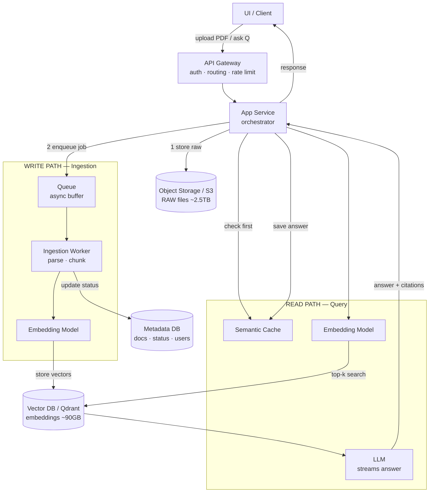
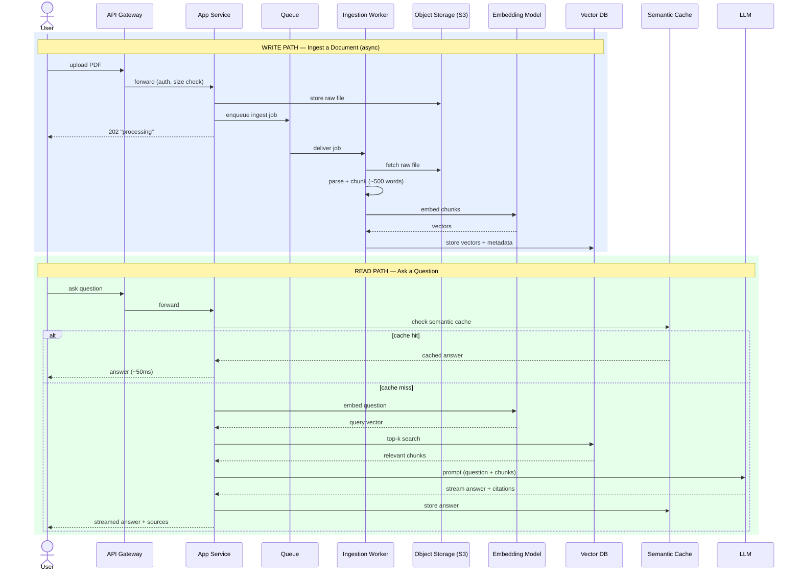

# Architecture & Flow Diagrams

GitHub renders the Mermaid diagrams below automatically.

---

## 1. High-Level Architecture (Components + Data Flow)

---

## 2. Request Flow (Sequence Diagram)

---

## Key Design Decisions

- **Raw files → S3; embeddings → Vector DB** (never store raw PDFs in the vector DB).
- Ingestion is **async via a queue** so the user never waits on parsing.
- The read path is **cache-first** for repeated/similar questions.
- The LLM **streams** its answer to cut perceived latency.
- **Citations** are attached on the return path to satisfy auditability.
